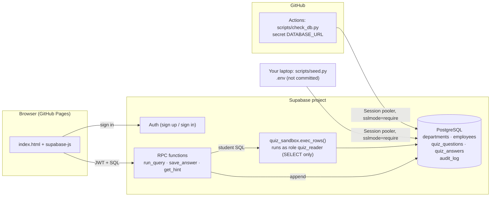

# SQL Quiz — Employees database

[](https://github.com/yiranch017/SQL-Quiz/actions/workflows/ci.yml)

### 🔗 Quiz site: **https://yiranch017.github.io/SQL-Quiz/**

A 20-point SQL quiz that runs **your** queries against a **live PostgreSQL database** (Supabase).
Sign in, pick a question, type SQL, press **Run**, and see the rows come back from the database.
Save an answer and the server checks your result against the expected result.

*Week 7 major assignment — IDS 706.*

---

## Contents
1. [How to take the quiz](#how-to-take-the-quiz)
2. [What is in the quiz](#what-is-in-the-quiz)
3. [Architecture](#architecture)
4. [Assignment requirements → where to find them](#assignment-requirements--where-to-find-them)
5. [Set it up yourself (step by step)](#set-it-up-yourself-step-by-step)
6. [Security design](#security-design)
7. [Extra credit](#extra-credit)
8. [Testing](#testing)
9. [Repository layout](#repository-layout)
10. [Troubleshooting](#troubleshooting)

---

## How to take the quiz

1. Open **https://yiranch017.github.io/SQL-Quiz/**.
2. **Create account** (email + password of 6+ characters), confirm the email if asked, then **Sign in**.
   Signed-out visitors see nothing but the sign-in form: they cannot see questions, run a query or save.
3. Choose a question on the left (Q1–Q5). The tables you can query are listed under the questions.
4. Type a query in the editor and click **▶ Run** (or press Ctrl/⌘ + Enter). The result table appears below.
5. **Save answer** stores your SQL and checks it: if your *rows* match the expected rows you get the points.
   You can re-save as often as you like; the latest saved answer counts.
6. **Show hint** reveals the expected SQL and the expected result table (it is recorded in the audit log).
7. **My activity** at the bottom shows your own audit-log entries.

Marking looks at the **result set**, not your exact SQL. Column names/aliases are ignored, `4.50` equals `4.5`,
and row order only matters on questions that ask for an ordering (Q1, Q4).

Only a single `SELECT` / `WITH … SELECT` statement is accepted (no `INSERT/UPDATE/DELETE`, no `;` stacking).
Results are capped at 200 rows.

## What is in the quiz

**Topic: employee data.** A synthetic company with two related tables, mixing categorical columns
(department, job title, employment type, city) and numeric/date columns (salary, rating, hire date).
The data is generated from a fixed random seed (`scripts/generate_data.py`) so the answers never change.

| Table | Rows | Columns |
|---|---|---|
| `departments` | 6 | `id`, `name`, `location`, `annual_budget` |
| `employees` | 60 | `id`, `first_name`, `last_name`, `department_id` → `departments.id`, `job_title`, `employment_type` (Full-time / Part-time / Contract), `city`, `hire_date`, `salary`, `performance_rating` (1.0–5.0) |

| # | Skill | Question | Points |
|---|---|---|---|
| 1 | `SELECT` · `ORDER BY` · `LIMIT` | First name, last name and salary of the 5 highest-paid employees, highest first | 4 |
| 2 | `JOIN` · `WHERE` | Full-time Sales employees with a performance rating ≥ 4.0 (name + job title) | 4 |
| 3 | `GROUP BY` · aggregates | Per employment type: headcount and average salary (rounded to a whole dollar) | 4 |
| 4 | `JOIN` · `GROUP BY` · `HAVING` | Departments whose average salary is above 80 000, with the average to 2 decimals, highest first | 4 |
| 5 | Correlated subquery | Per department, how many employees earn more than their own department's average | 4 |
| | | **Total** | **20** |

Every question has a **hint**: the expected SQL plus the expected result (computed live from the database).
The full list, written out, is in [`docs/answer_key.md`](docs/answer_key.md).

## Architecture



* **The browser never holds a database password.** It holds only the public project URL + anon key and the
  user's sign-in token. All access to quiz data goes through three server-side functions.
* **Python scripts** (seeding, CI checks) connect straight to Postgres over the network through the
  **Session pooler** with `sslmode=require`, using `psycopg2`, exactly like the in-class lab.

## Assignment requirements → where to find them

| Requirement | Done with | Where |
|---|---|---|
| Hosted PostgreSQL | Supabase (free tier) | `db/schema.sql`, `db/*.csv`, `scripts/seed.py` |
| Authentication; signed-out users cannot run or save | Supabase Auth; every RPC checks `auth.uid()` and is `EXECUTE`-granted only to signed-in users; questions/answers are behind row-level security | `index.html` (sign-in UI), `db/schema.sql` (gating) |
| GitHub Actions with GitHub Secrets | Workflow reads the `DATABASE_URL` secret and runs `scripts/check_db.py` | `.github/workflows/ci.yml` |
| SQL quiz worth 20 points, hints, Run shows live rows | 5 × 4 points, hint = expected SQL + expected result | `db/questions.json`, `index.html` |
| README with quiz URL and setup | this file | |
| Extra: parameterized queries | all Python SQL uses bound `%s` parameters; DB functions bind values | [see below](#extra-credit) |
| Extra: audit log | `audit_log` table written by the server for every run / save / hint | [see below](#extra-credit) |
| Extra: taker cannot edit the audit log | no write privileges + append-only triggers + CI test | [see below](#extra-credit) |

## Set it up yourself (step by step)

You need: a free [Supabase](https://supabase.com) account, a GitHub account, Python 3.9+.

### 1. Create the Supabase project
1. Supabase dashboard → **New project**. Choose a name, **generate a database password and save it immediately**
   (Supabase will not show it again), pick the region nearest you, create.
2. Wait until the project is active.

### 2. Get the connection string (Session pooler)
Click **Connect** at the top of the project → **Connection string** → choose **Session pooler**
(*not* "Direct connection": that is IPv6-only and fails on many networks and on GitHub's runners; *not* "Transaction pooler").
It looks like `postgresql://postgres.<ref>:[YOUR-PASSWORD]@aws-0-<region>.pooler.supabase.com:5432/postgres`.

### 3. Local `.env` (never committed)
```bash
git clone https://github.com/yiranch017/SQL-Quiz.git && cd SQL-Quiz
cp .env.example .env          # then edit .env and fill in DATABASE_URL
python3 -m venv .venv && source .venv/bin/activate
pip install -r requirements.txt
```
Replace `[YOUR-PASSWORD]` in `DATABASE_URL`. If the password contains special characters (`@ : / ? # %`),
URL-encode it: `python -c "import urllib.parse as u; print(u.quote('your password', safe=''))"`.
`.env` is in `.gitignore`; the code adds `sslmode=require` itself.

### 4. Create the tables, load the data and the questions
```bash
python scripts/seed.py
```
Expected output:
```
schema applied
loaded 6 departments, 60 employees
loaded 5 questions worth 20 points
```
It is safe to re-run: the schema is idempotent, the quiz data is reloaded, and students' saved answers
and the audit log are never touched. Look at the **Table Editor** in Supabase to see the rows.

### 5. Authentication settings (Supabase → Authentication)
* **Providers → Email** is enabled by default.
* By default Supabase emails a confirmation link on sign-up. Either keep that, or for a classroom demo turn off
  **Authentication → Sign In / Providers → Email → Confirm email** so new accounts can sign in immediately.
* **URL Configuration → Site URL**: set it to `https://yiranch017.github.io/SQL-Quiz/`
  so confirmation emails link back to the quiz.

### 6. Point the web page at your project
Supabase → **Project Settings → API**: copy the **Project URL** and the **anon public** key into `config.js`
and commit it. Both values are public by design (what a visitor can do is enforced inside the database).
**Never** put the `service_role` key or the database password in `config.js`.

### 7. GitHub Secret + Actions
1. GitHub repo → **Settings → Secrets and variables → Actions → New repository secret**.
2. Name: `DATABASE_URL`, value: the same Session-pooler URL as in your `.env`.
3. **Actions → Database check → Run workflow** (it also runs on every push to `main` and weekly).
   The workflow file only references `${{ secrets.DATABASE_URL }}`; no password is in the repo.

### 8. Publish the site (GitHub Pages)
Repo → **Settings → Pages → Build and deployment → Source: Deploy from a branch → `main` / `(root)`**.
After a minute the quiz is live at `https://yiranch017.github.io/SQL-Quiz/`.

## Security design

Letting strangers type SQL into your database is the dangerous part of this project, so it is layered:

1. **Sign-in gate.** `run_query`, `save_answer` and `get_hint` are `SECURITY DEFINER` functions that raise
   `Sign in required` when `auth.uid()` is null, and `EXECUTE` is granted only to the `authenticated` role
   (revoked from `anon`/`public`). A signed-out visitor gets *permission denied* from the database itself,
   not just a hidden button.
2. **Least-privilege sandbox.** The student's SQL runs inside `quiz_sandbox.exec_rows()`, a function **owned by the
   `NOLOGIN` role `quiz_reader`**, which holds `SELECT` on `departments` and `employees` and **nothing else**. Even
   a clever query cannot write, cannot read `quiz_questions` (hints), `quiz_answers`, `audit_log` or `auth.users`.
3. **Shape checks.** Only one `SELECT`/`WITH` statement, ≤ 4000 characters; wrapped as a sub-select; 200-row cap.
   (This is defence in depth: layer 2 is what actually enforces read-only.)
4. **Row-level security.** Users can read only their own `quiz_answers` and `audit_log` rows; hint SQL is hidden from
   direct table reads (column-level grants), so it is only available through `get_hint` (which is logged).
5. **Timeouts.** Supabase applies a default statement timeout to API roles, so a runaway query is cancelled and
   reported as “Query took too long”.
6. **No secrets in git.** `.env` is ignored; CI reads the GitHub Secret; `config.js` holds only public values.

Known limits (acceptable for a classroom quiz): a `;` inside a string literal is rejected as “extra statement”;
duplicate output column names collapse into one in the results table (alias them); 60-row toy data only.

## Extra credit

### 1. Parameterized queries (no f-string SQL)
* `scripts/seed.py` loads every CSV row and question with bound parameters
  (`cur.executemany("insert into … values (%s, %s, …)", rows)`); nothing is formatted into a SQL string.
* `scripts/check_db.py` passes every value (user ids, question ids, roles' test queries) as `%s` parameters.
* Inside the database, `run_query`/`save_answer`/`get_hint`/`_audit` take their inputs as typed function
  parameters and PL/pgSQL variables, which Postgres binds as values.
* The *only* dynamic SQL in the system is the student's own query — that is the point of a SQL quiz — and it is confined
  by the sandbox described above rather than by string escaping.

### 2. Audit log — who ran or saved what
Table `public.audit_log` records **user id, email, action (`run` / `save` / `hint`), question, the SQL text,
success, row count, error and timestamp**. Rows are written by the server-side functions, so a client can’t forge
or skip them. Each user can read their own rows in the page (**My activity**); the owner can see everyone’s:

```sql
select created_at, user_email, action, question_id, success, left(sql, 60) as sql
from audit_log order by id desc limit 20;
```

### 3. Integrity check — the taker role cannot edit the log
(The assignment lists this as the third extra; it is implemented too.)
* **Privileges:** `anon` and `authenticated` have no `INSERT/UPDATE/DELETE/TRUNCATE` on `audit_log`
  (`SELECT` on own rows only).
* **Triggers:** `BEFORE UPDATE OR DELETE` and `BEFORE TRUNCATE` triggers raise *“audit_log is append-only”*
  for everybody, including the table owner.
* **Proof:** `scripts/check_db.py` impersonates a signed-in user and asserts that INSERT, UPDATE, DELETE and
  TRUNCATE on `audit_log` all fail, and that the owner-level triggers fire. It runs in every GitHub Actions run.

## Testing

| What | How | Where |
|---|---|---|
| Hosted DB health + security (34 checks) | `python scripts/check_db.py` | runs in GitHub Actions with the secret |
| Grading logic (equivalent queries pass, wrong ones fail, ordering rules, upsert) | `python tests/local_grading_test.py` against a scratch local Postgres seeded with `tests/local_supabase_stub.sql` | local only (inserts a fake `auth.users` row) |

`check_db.py` runs in one transaction that is rolled back, so it leaves no data behind.

To regenerate the answer key from the live data: `python scripts/answer_key.py`.

## Repository layout

```
index.html                 the whole front-end (sign-in, questions, editor, results, hint, activity)
config.js                  public Supabase URL + anon key (edit this)
db/schema.sql              tables, roles, RLS, sandbox, RPC functions, audit triggers (idempotent)
db/departments.csv         quiz data (generated)
db/employees.csv           quiz data (generated)
db/questions.json          the 5 questions, points and hint SQL
scripts/db.py              connection helper (DATABASE_URL, sslmode=require)
scripts/seed.py            apply schema + load data + questions
scripts/check_db.py        health/security checks used by CI
scripts/generate_data.py   deterministic dataset generator
scripts/answer_key.py      writes docs/answer_key.md
tests/                     local grading test + stub of Supabase's auth schema
.github/workflows/ci.yml   GitHub Actions workflow (uses secrets.DATABASE_URL)
.env.example               template for your local .env (the real .env is git-ignored)
```

## Troubleshooting

| Symptom | Fix |
|---|---|
| Page says **Setup needed** | `config.js` still has placeholders — paste the Project URL and anon key. |
| `Tenant or user not found` / `password authentication failed` | `DATABASE_URL` user must be `postgres.<project-ref>` (with the dot and id); check the password / URL-encoding; wait 60 s after a reset. |
| Connection timed out / cannot resolve host | You used the *Direct connection*. Use the **Session pooler** host (`…pooler.supabase.com`). Some campus Wi-Fi blocks port 5432 — try a hotspot. |
| `Project paused` | Free projects pause after ~7 idle days; click **Restore project**. The weekly Actions run helps prevent this. |
| Sign-up says “check your email” and sign-in fails | Confirm the email first, or disable **Confirm email** in Supabase Auth settings. |
| Actions fails with `DATABASE_URL is not set` | Add the repository secret (step 7). Secrets are not passed to workflows from forks. |
| `permission denied for function …` in the page | Run `python scripts/seed.py` again to (re)apply grants in `db/schema.sql`. |
| `must be member of role "quiz_reader"` while seeding | Connect as the `postgres` user (the Session-pooler string from the dashboard), not a restricted role. |
